# EVA Strat

Outil pour **préparer ses stratégies** et **analyser ses parties** du jeu EVA : on lui donne une vidéo de partie, il retrouve les games, les joueurs, leurs positions, les kills et le score, puis rejoue la partie sur le plan de la carte.

**Tout tourne sur ton ordinateur** : pas de compte, pas d'abonnement, aucun service en ligne.



## Ce que fait le programme

**Fonctions principales**

- **Analyse** : repère les games d'une vidéo par le chrono, lit les pseudos, l'équipement, les kills, le score de capture, puis les **positions et regards des joueurs** sur la minimap. Replay sur le plan de la carte, en même temps que la vidéo.
- **Stratégie** : importer le plan d'une carte, le dessiner (lignes, formes, crayon, couleurs, jusqu'à 3 étages), poser des armes avec leur portée. Sauvegarde automatique par carte dans le navigateur, export et import JSON.
- **Armes** : nommer les icônes d'armes vues par l'analyse (une fois nommées, elles servent à toutes les vidéos).

**Fonctions secondaires**

- Corrections à la main (position, regard, joueur mort) qui servent d'indications au suivi, commentaires liés à un instant de la vidéo, noms des équipes par morceau de vidéo.
- Téléchargement d'une vidéo YouTube (1080p, refusé avec un message clair si YouTube ne propose que du 360p).
- **Priorité de l'analyse** (basse, normale, haute) pour aller plus vite quand le PC n'a rien d'autre à faire.
- **Export et import des données** en fichiers JSON, pour une clé USB, un disque externe ou un autre PC.
- Réglages avancés : cartographie à la main des cartes, calibrage de l'écran (voir « Avancé »).

En préparation : un onglet **Stats** (parcours des joueurs, morts, retakes, rotations), plan dans [`docs/PLAN_STATS_AGENTS.md`](docs/PLAN_STATS_AGENTS.md).

## Tout tourne en local : pourquoi

- **Les vidéos sont lourdes** (plusieurs Go) : le programme les lit directement sur ton disque avec ffmpeg, sans rien envoyer.
- **Tes stratégies restent à toi** : les replays d'entraînement d'une équipe ne quittent pas la machine.
- **Gratuit** : pas d'IA en ligne ni de service payant. Les pseudos et le killfeed sont lus par la reconnaissance de texte déjà présente dans Windows.
- **Tu possèdes tes données** : un fichier SQLite (`data/eva.db`) et un export JSON lisible par n'importe quel outil.
- Le site n'écoute que sur ton PC (`http://localhost:5173`) et refuse les requêtes venues d'ailleurs. Internet n'est utilisé qu'à l'installation (npm, pip, ffmpeg) et pour télécharger une vidéo YouTube si tu le demandes.
- Conséquences : **Windows** est nécessaire pour l'analyse, et le calcul se fait sur ton PC : la durée dépend de la vidéo et de la machine (sur l'ancien PC de développement : une à deux heures pour une vidéo de 58 minutes). La priorité de l'analyse se règle dans Options.

## Les onglets

| Groupe | Onglet | Pour quoi faire |
|---|---|---|
| Usage courant | **Stratégie** | dessiner et préparer ses plans |
| Usage courant | **Analyse** | charger une vidéo, lancer l'analyse, voir le replay |
| Usage courant | **Armes** | nommer les icônes d'armes |
| **Avancé** | **Lecture** | ce que le programme sait des cartes, corrections à la main, cartographie |
| **Avancé** | **Données** | place prise, export et import JSON, effacement du cache |

> **Avancé = à tes risques et périls.** Ce qui y est modifié (cartographie, corrections, « Appliquer au programme », calibrage de l'écran) **change les calculs** de l'analyse : on suppose que tu sais ce que tu fais, et il vaut mieux sauvegarder avant (onglet Données > Exporter). Et **réinstaller le programme sans copier ses données peut les faire disparaître** : lis la section « Réinstaller sans perdre ses données ».

## Installer

Il faut **Windows 10 ou 11**, [Node.js](https://nodejs.org/) 22 ou plus (version LTS) et [Python](https://www.python.org/downloads/) 3.10 ou plus (coche « Add python.exe to PATH » à l'installation). ffmpeg s'installe tout seul.

1. Installe Node.js et Python.
2. Télécharge le projet : sur GitHub, choisis la branche `feat/onglet-analyse` puis **Code > Download ZIP**, et dézippe-le où tu veux (par exemple `Documents\eva_strat`). Avec Git : `git clone <adresse>` puis `git checkout feat/onglet-analyse`.
3. Ouvre un terminal dans ce dossier (dans l'Explorateur, tape `cmd` dans la barre d'adresse puis Entrée) et lance :

```bash
npm start
```

La première fois, il installe ce qui manque (paquets npm, bibliothèques Python, ffmpeg par winget) puis ouvre le site sur http://localhost:5173. Les fois suivantes, `npm start` lance directement le site. Pour l'arrêter, ferme la fenêtre du terminal.

Si `npm` échoue avec une erreur de certificat SSL : `set NODE_OPTIONS=--use-system-ca` puis relance. Pour utiliser un autre Python : variable `EVA_PYTHON`.

## Utiliser



1. **Analyse > Parcourir** (ou colle un lien YouTube) pour charger la vidéo.
2. **Détecter les games** : le chrono est lu, les games apparaissent en liste.
3. Vérifie les bornes (les bandes orange de la frise sont les passages incertains), puis confirme.
4. **Analyse détaillée** : coche les games et lance l'analyse. Menu **Options > Priorité** : *basse* (le PC reste fluide), *normale* (réglage de Windows) ou *haute* (plus rapide quand d'autres programmes se partagent le processeur ; le PC peut devenir moins réactif). L'analyse tourne sur ton PC : changer d'onglet ou recharger la page ne l'arrête pas, fermer le terminal oui.
5. Sélectionne une game : replay sur le plan, kills, score de capture. Onglet **Armes** : nomme les icônes que le programme ne connaît pas encore.

## Tes données : où elles sont, combien elles pèsent

| Quoi | Où | À savoir |
|---|---|---|
| Games, positions, kills, corrections, commentaires, calibrages | `data/eva.db` | **le plus précieux** ; ignoré par Git |
| Noms et images des armes | `analysis/weapon_icons/` | doivent rester avec la base : elle cite les icônes par numéro (B25, G9...) |
| Cartes que tu as « appliquées » | `analysis/map_masks/`, `analysis/map_*.json` | seulement si tu as utilisé l'outil de cartographie |
| Cache | `data/cache/` | vidéos téléchargées, lectures gardées (se refont) |
| Tes vidéos | là où tu les as rangées | la base en garde le chemin complet |
| Cartes de l'onglet Stratégie | le navigateur | à exporter en JSON depuis l'onglet ; un autre navigateur ou une autre adresse ne les voit pas |

**Poids** (mesuré sur 32 games dont 13 analysées) : la base fait 23,4 Mo, soit environ 1,8 Mo par game analysée, presque tout en positions (extrapolation, non mesurée : 100 games analysées, environ 180 Mo). Ce qui pèse vraiment, c'est le **cache** : une vidéo YouTube téléchargée fait plusieurs Go (2,6 Go ici) et les lectures gardées 137 Mo. L'onglet **Données** donne ces chiffres chez toi et efface les lectures gardées (elles se refont, 1 à 2 minutes par game) ; les vidéos téléchargées sont à supprimer à la main.

### Clé USB, disque externe : exporter, ne pas y mettre la base

La base écrit sans cesse et un débranchement en cours d'écriture peut la corrompre ; une clé s'use surtout à l'écriture. Lire ne l'use pas. Le programme n'y lit donc pas sa base : il **exporte** vers un dossier, une seule fois par game.



- **Données > Dossier > Exporter** : un fichier compressé par game, plus les réglages et les icônes. Mesuré : 32 games en 5 Mo (contre 23 Mo de base). Un deuxième export n'écrit que ce qui a changé.
- **Données > Dossier > Importer** (ou « Voir ce qui serait importé » d'abord) : ajoute les games absentes, ne touche jamais celles déjà présentes, traduit les numéros d'icônes d'armes, et fait une copie de la base avant d'écrire.
- Les avis et verrous d'icônes ne voyagent pas (jugements locaux). En ligne de commande : `python analysis/data_export.py export E:\sauvegarde` et `import`.

### Réinstaller sans perdre ses données

**Méthode simple, sans Git ni IA (export puis import)**

1. Ancienne installation, onglet **Données** : choisis un dossier (clé ou disque) et **Exporter**.
2. Ferme le site. Télécharge la nouvelle version dans un **nouveau dossier** (ne supprime pas l'ancien).
3. `npm start` dans le nouveau dossier, onglet **Données**, même dossier, **Importer**.
4. Vérifie que tes games sont dans l'onglet Analyse, puis seulement supprime l'ancien dossier.

**Méthode par copie de dossiers**

1. Site fermé, dans le **nouveau** dossier, remplace `data` et `analysis\weapon_icons` par ceux de l'ancien. Copie aussi `analysis\map_masks` et `analysis\map_*.json` **seulement si tu as utilisé l'outil de cartographie** (sinon tu écraserais les cartes de la nouvelle version).
2. `npm start`. La base d'une ancienne version s'ouvre avec la nouvelle : les colonnes et tables manquantes sont ajoutées à l'ouverture (vérifié avec une base du 10 octobre : aucune ligne perdue). L'inverse (ouvrir une base récente avec une vieille version) n'est pas prévu.
3. Les chemins des vidéos sont enregistrés en absolu : si tu les as déplacées, voir [`docs/CHANGER_DE_PC.md`](docs/CHANGER_DE_PC.md).

**Avec Git (développeurs)**

```bash
# site fermé ; sauvegarde d'abord (data/ n'est pas dans Git)
xcopy data ..\eva-data-sauvegarde /E /I
git status                                # ce que tu as modifié : icônes, cartes
git add analysis/weapon_icons analysis/map_masks analysis/map_*.json
git commit -m "mes données"
git pull --rebase                         # en cas de doute : git rebase --abort
npm start
```

Un nouveau `git clone` ne contient jamais `data/` : copie-le depuis l'ancien dossier. Ne lance jamais `git clean -fdx` (il efface `data/`).

### Placer ses données ailleurs, utiliser sa propre base

Avant `npm start`, dans le même terminal :

```bash
set EVA_DATA_DIR=D:\eva-data     # dossier de la base et du cache (PowerShell : $env:EVA_DATA_DIR = "D:\eva-data")
set EVA_DB=D:\copie\eva.db       # ou seulement le fichier de la base
set EVA_CACHE=D:\gros-cache      # ou seulement le cache (vidéos téléchargées)
```

Pour que ce soit permanent : `setx EVA_DATA_DIR "D:\eva-data"` (nouveau terminal ensuite). **PS : ta propre base** : `EVA_DB` accepte tout fichier SQLite au format du programme (la base d'un coéquipier, une copie d'essai). Une autre sorte de base (PostgreSQL, MongoDB...) n'est pas prise en charge ; l'export JSON sert de passerelle : chaque game est un document `{format, uid, video, game, tables: {nom: {columns, rows}}}` (JSON compressé gzip), facile à charger ailleurs. L'onglet Données avertit si la base est sur une clé USB ou un disque réseau ; Windows déclare souvent « fixe » un SSD ou disque dur USB, qui n'est donc pas repéré : l'avertissement ne remplace pas la prudence.

## Avancé : ce qui change les calculs

- **Lecture > Joueurs sur la minimap** (corrections à la main) : tes positions, regards et morts servent d'indications au suivi ; « Recalculer avec mes corrections » refait les positions de la game.
- **Lecture > Cartographie à la main** : « Appliquer au programme » réécrit les masques et fichiers de la carte, et les positions déjà lues ne changent qu'à la prochaine analyse.
- **Analyse > Options > Calibrer les zones du HUD** : si les zones sont fausses, tout ce qui est lu l'est aussi.
- Les règles du suivi sont versionnées (`ALGO_REVISION` dans `analysis/tracking.py`) : changer l'algorithme fait relire les positions au prochain « Analyser ».

## Pour les développeurs

```bash
npm run dev                  # site de développement (http://localhost:5173)
npm run test:js              # tests du site et du serveur
python -m pytest -q          # tests de l'analyse
npx tsc -b                   # typage
```

Pile : [Vite](https://vite.dev/) + React + TypeScript, [Konva](https://konvajs.org/), [Zustand](https://github.com/pmndrs/zustand), serveur d'analyse en plugin Vite (SQLite), analyse en Python (OpenCV, ffmpeg).

- [`ARCHITECTURE.md`](ARCHITECTURE.md) : carte du projet (fichiers, routes de l'API, flux), à lire avant de chercher ou de créer un fichier.
- [`CLAUDE.md`](CLAUDE.md) : règles de travail, commandes et pièges techniques mesurés.
- [`docs/DETAILS_ANALYSE.md`](docs/DETAILS_ANALYSE.md) : fonctionnement détaillé de chaque lecture (games, pseudos, kills, positions, replay, cartes).
- [`docs/CHANGER_DE_PC.md`](docs/CHANGER_DE_PC.md) : installer sur un autre PC, chemins des vidéos.
- [`docs/PLAN_RESTANT.md`](docs/PLAN_RESTANT.md), [`docs/PLAN_OPTIMISATIONS.md`](docs/PLAN_OPTIMISATIONS.md), [`docs/PLAN_STATS_AGENTS.md`](docs/PLAN_STATS_AGENTS.md) : ce qui reste, vitesse, onglet Stats.
